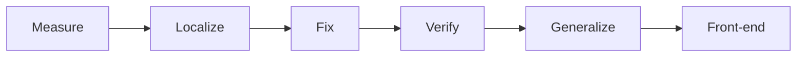

# Reasoning Reliability

Find where a language model breaks at reasoning, locate that failure inside the model, and fix it more effectively than generic interventions. Same accuracy can hide different weaknesses; profiles and internals make those weaknesses actionable.

## Status

Design stage (v3). First focused cut is **Q1** (state loss: read vs computed competitors) — draft for review, 13 Nov 2026. Specs in [`docs/q1/`](docs/q1/); plan summary [`docs/q1/plan.md`](docs/q1/plan.md). No Q1 code until sign-off. `src/` stays a placeholder until the design is frozen.

## Plan in one line

Measure (breaking points) → Localize (internal signal) → Fix → Verify (vs generic and mismatch) → Generalize (new model family). Eventually: reliability front-end (rewrite, monitor, adaptive compute).



Full diagram set: [`docs/flowcharts.md`](docs/flowcharts.md).

## Where to look

| File | What it is |
|---|---|
| `docs/q1/` | **Q1 specs** (UpdateLedger, E0–E5, prereg, benchmarks) — first demo cut |
| `docs/q1/plan.md` | Q1 draft plan (claims, models, prior art, open decisions) |
| `docs/research_design.md` | Canonical research design (v3 pipeline, RQs, stages, stats, product) |
| `docs/flowcharts.md` | Clean Mermaid diagrams for the whole programme |
| `research_design.md` | Short mental-model overview (points to docs) |
| `discussion.md` | Nov 4 discussion log that set the v3 direction |
| `docs/eval_suite.md` | Families, selection rules, benchmark review, generator build rules |
| `docs/root_abilities.md` | 8 root abilities, ladders, profile measures |
| `docs/roadmap.md` | Phases, weeks and gates |
| `docs/checklist.md` | What is done and what is next |
| `docs/decisions.md` | Dated log of every design decision |
| `docs/model_selection.md` and `configs/models.yaml` | Models and why |
| `configs/study.yaml` | Study settings |
| `docs/compute.md` | GPUs (JarvisLabs) |
| `docs/runner_requirements.md` | Rules the runner must meet before any GPU run |
| `docs/architecture.md` | Data flow, code layout, front-end sketch |
| `docs/reading_list.md` | Papers and labs to read |
| `docs/v1_audit.md` | What went wrong in v1 and what we keep |
| `research-vault/00_Home.md` | Obsidian home (open the repo root as the vault) |
| `site/` | Interactive research website (static; includes flowchart viewer) |
| `flow_chart.md` | Raw ChatGPT export; superseded by `docs/flowcharts.md` |

## Rules

- Raw logs are the truth. Append-only, never edited.
- Every prompt difference must be intended. QA tests block runs that fail.
- Answers are checked by program, never by trusting written reasoning.
- Hypotheses and the main tests are pre-registered before confirmatory runs.

## Interactive research site

Static site in the same style as
[retrieval-vs-computation](https://adya6714.github.io/retrieval-vs-computation/):
left rail, full-page panels, Instrument Serif / Inter, playable explorers.

```sh
cd site
python3 -m http.server 5173
```

Open http://127.0.0.1:5173/ · details in `site/README.md`.

Live: [adya6714.github.io/reasoning-reliability](https://adya6714.github.io/reasoning-reliability/)

## Setup

```sh
uv sync --extra analysis --extra dev
uv run rr --help
```
