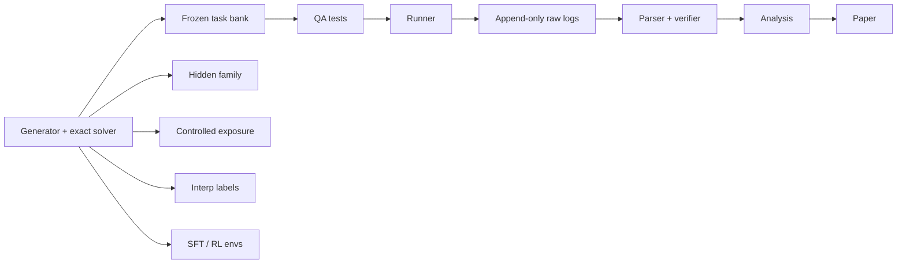

# Architecture

Programme flowcharts (Mermaid): `docs/flowcharts.md`.

## Data flow

```text
generator + exact solver ──> frozen task bank (JSONL) ──> QA tests ──> runner
                                                                         │
                                                         append-only raw logs (JSONL)
                                                                         │
                                                         parser + verifier ──> analysis ──> paper
```



Same generators also feed: hidden family, controlled exposure data, labelled interp examples, RL/SFT environments.

## Code layout (target)

`src/reasoning_reliability/`:

- `items/` generators with difficulty knobs and seeds
- `surfaces/` rewrites applied by code (never by an LLM rewriting whole prompts)
- `protocol/` one fixed answer-format wrapper, added after rewriting
- `verify/` solvers and parsers (ported from v1 with tests)
- `run/` vLLM and API runners (see `docs/runner_requirements.md`)
- `probes/` behavioural and internal probes
- `analysis/` mixed-effects models, bootstrap, IRT, Kendall W
- `intervene/` (later) steering, harness hooks, weight-edit adapters

Also: `configs/` (models pinned by revision), `prereg/`, `runs/` (append-only), `tests/qa/`, `data/private/` (gitignored: hidden family and seeds).

## QA tests (block any run that fails)

- Instruction text identical across rewrites
- Gold re-solved for every variant
- Prompt length within a band
- Difficulty matched for reversals
- Whole-word renames only
- Equivalence check by a non-evaluated model

## Current state

`records.py`, `client.py`, `runner.py` and `cli.py` are a placeholder scaffold. They will be rebuilt in Block C.

## Harness layer

For agent and tool studies, add a versioned harness between model and task. Record model, harness version, tool/memory/retry policy and seed separately; compare same model with different harness, and different models with one harness. When measuring the model, hold harness and format fixed.

## Reliability front-end (v3 product sketch)

```text
User task → Demand tagger → Risk vs model profile → Front-end → Main LLM → Answer
                                      │
                                      ├─ Query rewriter (model-specific)
                                      ├─ Runtime monitor (about-to-fail signals)
                                      └─ Compute allocator (more budget on high-risk steps)
```

- **Query rewriter:** diagnosis-guided, not generic prompt optimization alone.
- **Runtime monitor:** catch looping, state loss, early stop; intervene before compounding.
- **Compute allocator:** compare breaking points to task demands; use live uncertainty and probes.
- **Demand tagger:** open challenge (train on generated tasks with known demands; calibrate on about 20 to 50 real tasks).

Load-rating analogy: profile the model once; rate each new task against that profile.
