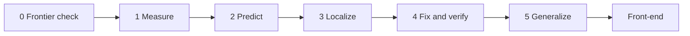

# Research design

Canonical design as of 2026-11-04 (v3). Narrative discussion: `discussion.md`. Mental-model overview: `research_design.md` at repo root (points here).

## 1. Question

> Can we identify how a model is likely to fail before it fails, understand what is happening inside the model when it fails, and use that understanding to fix the problem more effectively than generic interventions?

| Version | Question |
|---|---|
| V1 | Are models sensitive to small changes in questions and instructions? |
| V2 | Can we measure different reasoning abilities and use their profiles to predict failures on unseen tasks? |
| V3 (current) | Can we measure a failure, identify its internal mechanism, intervene on it, and verify that the intervention improves reliability? |

Mechanistic interpretability is part of the central programme, not an optional extension. Root-ability ladders remain the instrument that generates controlled, labelled failures. Prediction (B3 vs B2) stays as a supporting scientific question and Phase 1 checkpoint.

**Goals:** a repeatable diagnose → localize → fix → verify pipeline that runs on new open models; an eval suite; eventually a reliability front-end (query rewriting, runtime monitoring, adaptive compute).

## 2. Central pipeline

Diagrams for this section and the rest of the design: `docs/flowcharts.md` (architecture, taxonomies, ladders, benchmarks, stats, interp, fixes, front-end, roadmap).

| Stage | Name | What | Gate / note |
|---|---|---|---|
| 0 | Frontier check | L1 to L3 ladders on current frontier models (Opus, Fable, Astra, GLM, and peers) | Models still break somewhere; if not, extend ladders first |
| 1 | Measure | Controlled generators, L1 to L4 ladders, breaking-point profiles | RQ1: stable behavioural contrast above noise. Gates later stages |
| 2 | Predict | Three-baseline race on the hidden deterministic tool-use sandbox | Reported checkpoint. Does **not** gate Stages 3 to 5 |
| 3 | Localize | Probes, patching, lens comparison, steering/ablation | Pre-registered Stage 3 pass bars |
| 4 | Fix and verify | Targeted harness / steering / weight edit / SFT / RL vs matched, strong, mismatch | Targeted beats baselines on reliability per unit cost; measure what each fix breaks |
| 5 | Generalize | Re-run pipeline on another open model family | Minimal manual intervention |
| Later | Reliability front-end | Query rewrite, runtime monitor, adaptive compute | Product layer; research makes it better than generic prompt optimizers |

Do not look inside a model without first knowing which failure you are explaining.

## 3. Research questions

| RQ | Question |
|---|---|
| RQ1 Measurement | Can each ability be measured per problem, above noise, separately from the others? |
| RQ2 Beyond general skill | Do abilities add information beyond overall ability? |
| RQ3 Prediction | Do profiles predict specific failures on a task family never used for profiling? |
| RQ4 Origin | Memorized data, or a specific training step? |
| RQ5 Mechanism | Is there a signature inside the model? |
| RQ6 Reliability | Does a diagnosis-guided fix beat generic and mismatched fixes at matched cost? |

Order: label failures before looking inside; call a fix targeted only after you know its target. Stages 3 to 5 gate on RQ1, not RQ3.

**Assumptions:** answer-preserving rewrites exist and are solver-checkable; repeated samples estimate stable tendencies above a measured noise floor; abilities are hidden and seen only through behaviour; open models are representative, checked by a closed panel.

## 4. Dimensions (root abilities)

Spine: 8 root abilities with 4-level ladders. Full table: `docs/root_abilities.md`. Failure types: `research-vault/09_Test_Menu_and_Selection.md`.

- A model's **profile** = its breaking point on each ladder (for example state horizon at 50% accuracy).
- Mapping from 17 failure types to 8 abilities is a **DRAFT**. Abilities are candidates, not established independent faculties (R1/R8 and R2/R6 may overlap; R5 may mix mechanisms). Bifactor analysis tests distinguishability.
- Keep an ability only if: (1) theory supports it, (2) model rankings agree across 4 to 6 templates in at least 2 families (Kendall's W for 3+ templates), (3) it predicts failures beyond general skill **or** supports a clean localize/fix story for a chosen failure.
- Knowledge prerequisite tests remain a control, not a profile dimension.
- Coordination with another actor stays out of scope.

**First demonstration — Q1 (draft, 13 Nov 2026):** end-to-end on **state loss** (type 1 / R1) via UpdateLedger: read vs computed mode; competitors stale / neighbour / prior. Specs and plan: `docs/q1/`. **Looping** (type 4 / R2) remains a later demo candidate. Rule breaking is a third candidate.

Signature method carried from v1: plan/execute split with controlled **false-state injection** (know exactly when the error enters). Q1 adds a stronger variant: computed mode never writes the gold value, so interference cannot be pure surface retrieval.

## 5. Hypotheses

| # | Hypothesis | Refuted if |
|---|---|---|
| H1 | Accuracy-matched models differ on at least one ability | Differences within noise |
| H2 | Profile predicts failures on a hidden family beyond accuracy | No gain over accuracy plus difficulty |
| H3 | Abilities are distinct | Cross-ability correlations as high as within |
| H4 | Surface dependence rises with controlled exposure | No exposure gradient |
| H5 | Reactive models fail greedy traps beyond a lookahead horizon at equal accuracy | No trap gap difference |
| H6 | Planting a false step changes answers in faithful models only | Same effect everywhere |
| H7 | Removing step-by-step working raises surface dependence more for non-reasoning models | No interaction |
| H8 | Each OLMo training stage shifts specific abilities | No stage-specific change |
| H9 | Diagnosis-guided fix beats matched, strong generic, and mismatch controls on reliability per unit cost | No advantage |
| H10 | Question-only correctness signals work on recall-heavy items but fail on computation-heavy items; mid-reasoning signals close the gap; confidence is inflated on fresh twins of famous items | Equal performance across item types; no twin inflation |

## 6. The prediction test (supporting)

Predict failure on held-out families with three baselines:

- **B1:** overall ability
- **B2:** B1 + difficulty + domain + an ADeLe-style skill profile. Evaluate on **both** failure occurrence and failure type.
- **B3:** B2 + process measures (root-ability ladder profiles)

Claim if B3 clearly beats B2 on unseen families. Metrics: AUC and log-loss, cross-validated by family. Pre-register before data.

| Outcome | Action |
|---|---|
| Clear win | Stronger claim for profiles |
| Partial win | Narrower claim; report where it works |
| No win | Check measurement, then transfer; report the null; continue localize/fix if RQ1 holds |

**Instruction drift experiment (own pre-registered contrast; reference effect size):** 3 instruction levels (none, "show working", "final answer only") crossed with thinking on/off.

## 7. Evidence rules

- A rewrite drop is a symptom, not a diagnosis. Claim a cause only when answer-changing edits, controlled exposure, fresh twins and other probes agree.
- Surprising result: re-verify gold; hand-audit 30 failures; run the "prompts differ only as intended" check; rerun on fresh twins with a new seed; rerun on a second family; log every step in a result ledger.
- Repeatable runs are not faithful reasoning. Check answers by program.
- Never trust an LLM's written confidence without calibration.
- Hold harness and answer format fixed when measuring the model. Harness effects are a separate experiment.
- Probe AUROC is predictive; patching, steering and ablation strengthen the causal claim.

## 8. Stages (detail)

The core asset is a set of **generators with exact solvers**. Same generators feed the test bank, hidden family, controlled training data, labelled probing examples, and RL / SFT environments.

| Stage | Weeks (v2 baseline; treat as planning baseline only) | What | Output |
|---|---|---|---|
| 0 Frontier check | before instrument | L1 to L3 on frontier panel | Confirm ladders still break models |
| 1 Instrument + measure | 1 to 7 | Generators, rewrites, verifiers, QA, runner, noise floor; screening and fix-first pilots; main behavioural run | Trusted bank + profiles; Paper 1 measurement half |
| 2 Predict | with Stage 1 | Three-baseline test on hidden sandbox | Checkpoint result |
| 3 Causes | 8 to 10 | Controlled exposure (fine-tune OLMo 3 7B on half the items), one more open family; OLMo stages; OLMoTrace / infini-gram | RQ4 |
| 4 Localize | 11 to 16 | Probe ladder (below) | Paper 2 |
| 5 Fix and verify | 17 to 22 | Harness, rewrite-diverse SFT, RL, steering, weight edits; matched / strong / mismatch; what each fix breaks | Paper 3 |
| 6 Generalize | after first demo | New model family through the pipeline | Transfer evidence |

**Fix-first pilot (early):** majority vote, code tool, verifier, written state on pilot failures. If generic fixes repair almost everything, pivot toward reliability engineering.

**Stage 3 ladder** (stop if an early step finds nothing):

1. Linear probes: is "this will fail" readable before the failing step?
2. Activation patching: which layers and positions matter (pass↔fail)?
3. Compare 2 to 3 lenses on one target: neurons, Gemma Scope 2 (SAE or transcoder), ICA.
4. Steer or ablate with random-direction controls, dose response, side effects.
5. Attribution graph for one clean case, if tooling supports the model.

**Stage 3 pass bars (pre-register):**

- Probes: at least +0.05 AUROC over question-only and text-only baselines, CI excluding 0.
- Patching: at least 50% of the pass/fail gap recovered from 3 or fewer layers.
- Steering/ablation: effect beyond the 95th percentile of random-direction controls, with a dose response.

**Stage 4 / Fix baselines:**

- Matched: same data volume, steps and compute, no targeting.
- Strong: generic "check your work" prompting, and RL on pooled generators (plus uniform compute allocation where relevant).
- Mismatch: fix meant for a different weakness; if it works as well, diagnosis adds nothing.
- Always measure what each fix breaks and reliability per unit of cost.

Corpus search on models without public data is descriptive only; only controlled exposure is causal. Pythia and LLM360 checkpoints are optional for pretraining-over-time analysis.

## 9. Benchmarks and the eval suite

Full rules and review: `docs/eval_suite.md`.

- Contamination is a variable: pair famous items with fresh twins of identical structure and solver-verified gold.
- **5 profiling families:** A planning and greedy traps; B long state tracking and compound goals; C code execution (output prediction); D maths word problems with twins (own templates on GSM8K, MIT; do not derive from GSM-Symbolic); E logic and rule worlds.
- **Hidden family F:** deterministic tool-use sandbox (same abilities, different surface). Seeds in `data/private/`. Headline transfer test for RQ3.
- **Family G (proposed, not finalized):** long-horizon memory (multi-session changing facts). Main abilities R1, R3, R7. From Nov 4 discussion.
- Extend every ladder until frontier models break. The suite is a named contribution of Paper 1.

PostTrainBench measures agents doing post-training, not reasoning; context for Stage 5 only.

## 10. Sample sizes, runs, analysis

- **Population claims:** about 300 structural items per family (50 famous, 50 twins, 200 fresh). Start every item at k=5; add samples only where the interval straddles the decision threshold (pre-registered adaptive rule). Noise floor from batch-size and seed reruns.
- **Per-problem claims:** 60 items per family at k=20.
- Split: 40% development, 60% confirmation (confirmation closed until design freeze).
- Final counts from a power simulation after the pilot. The unit is the item or template, never the repeated call.
- **Decoding:** temperature above 0 at model-card settings; small greedy check set; thinking on/off as a planned factor; report pass^k at k = 1, 4, 8.
- **Factor models:** baseline 2PL IRT. Main model: bifactor (one general factor + one specific factor per tagged ability), confirmatory because items are tagged in advance.
- **Simulations before the main run:** (a) model counts 6, 8, 12, 20, 30 for recovery threshold; (b) null with zero specific factors for false-positive rate; (c) null with format and template noise only. Match item difficulty across abilities; use the real pilot ability spread (avoid floor-driven fake factors). Target roughly 12+ relatively independent models for recovery.
- **Harness check:** one item subset under two scaffolds; Kendall's tau or Spearman's rho (not W: only 2 rankers); bootstrap over items for the CI.
- **Sensitivity:** model-item regression with a random effect per model family; also report B3 vs B2 with one variant per family.
- **Behavioural analysis:** mixed-effects logistic, `correct ~ variant x protocol x model + (1 + variant | item) + (1 | template)`; cluster bootstrap over templates; Holm correction; few pre-registered primary contrasts.
- **Logging:** see `docs/runner_requirements.md`.

## 11. Confidence signals

Logged in the screening pilot and every run after:

| Signal | Source |
|---|---|
| Written confidence | Generated text |
| k-sample agreement | Sampled answers |
| Gold-answer log-prob | Logits (open models) |
| Jev probability | External model, question + options |
| Rule-based score | Agreement, backtracking, family, difficulty, from our own records |

- Report Brier, reliability diagram and AUROC per family, split by famous vs fresh twin.
- Jev distractors come from the generator, never from evaluated-model samples.
- Agreement uses samples 1 to k; correctness is scored on held-out sample k+1.
- Expected weak spot: agreement can be 5/5 and wrong on fresh twins of famous items (misplaced retrieval).

## 12. Test menu and pilots

**15 tests:** answer-changing edits; changed-rule worlds; distractors; missing information; composition depth; length generalization; long state tracking; mid-problem change; self-correction under true or false feedback; misleading hints; two-way consistency; explanation vs answer; repeated sampling; confidence vs correctness; tool errors.

**Scoring (0 to 2 each):** hurts real users; clean control; known fix; less studied; cheap; inspectable inside.

**Screening pilot:** top 5 to 6 tests, pilot roster, about 50 items each, plus Jev and the confidence signals. Feasibility only, not claims.

**Fix-first pilot:** majority vote, code tool, verifier, written state on pilot failures.

## 13. Reliability front-end (product direction)

A layer between user and main LLM. Research pipeline supplies per-model weaknesses; product uses them.

1. **Query rewriting:** model-specific, diagnosis-guided restructure (not generic prompt optimization alone).
2. **Runtime monitoring:** catch "about to loop", "losing state", "about to stop early" via activations or behaviour; harness intervenes.
3. **Adaptive compute:** compare model breaking points to task demands; spend more tokens / samples / verification on high-risk steps.

**Load rating:** profile a model once; estimate task demands; compare. Calibrate on about 20 to 50 real customer tasks. **Demand tagger** (automatic task → demands) is an open engineering and research component.

What survives model upgrades: re-profile each new model; cost still matters; verification still needed.

## 14. Novelty

The broad version (multi-family stress tests, same score different profile) is taken. The open gap: connect the same labelled failures across stages:

Behavioural failure → internal signal → causal intervention → targeted fix → external verification.

| Route others took | Examples | Where it stops | What we take |
|---|---|---|---|
| Perturb and measure drop | GSM-Symbolic, GSM-Plus, GSM-SEM, Golsefid 2026 | A drop is only a symptom | Templated twins, paired tests |
| Counterfactual worlds | Wu et al.; Mystery Blocksworld | Unfamiliar is often also harder | Changed rules, difficulty matched |
| Trace to training data | Xie et al. (K&K); Ruis et al.; infini-gram | One domain; searched, not controlled | OLMo 3 and controlled exposure |
| Psychology batteries | CogBench, CogArena | General skill dominates | Theory of abilities; bifactor |
| Skill profiles predicting items | Beyond Scores, SkillEval, Burden et al., ADeLe | Knowledge skills, not process | Baseline B2 |
| Read the chain of thought | Lanham; Turpin | Not a reliable window | Check by program |
| Look inside first | Circuits, SAEs, neuron atlases | Which features matter is unknown | Tools, after labels |
| Just fix it | Self-consistency, verifiers, ReAct, RLVR | Which fix for which failure | Fix-first pilot, Stage 5 |
| Train from scratch | Physics of Language Models | Toy models | Middle road: fine-tune OLMo |

**Openings:** A process profiles and prediction; B controlled exposure; C one family (OLMo 3) for behaviour, stage and internals; D full diagnose → localize → fix → verify on one or two failures. Strongest: D plus C.

**Closest papers:** Golsefid 2026; Missing Primitive 2026; CogArena 2026; Beyond Scores 2026; ADeLe (Zhou et al. 2025). Full list in `docs/reading_list.md`.

**Pending verification before citing:** Qwen neuron persona atlas; MIT CSAIL / Astra-style weight-edit numbers in `discussion.md` (inspiration only until independently checked).

## 15. Papers (proposed split; finalize later)

Paper split (one long paper vs series) is still open. Natural three-paper cut:

1. **Measurement and prediction:** eval suite, taxonomy, profiles, bifactor, hidden-family race.
2. **Mechanism:** exposure, training stages, probes, patching, SAE/neuron analysis, causal interventions on one or two failures.
3. **Intervention and reliability:** targeted vs matched / strong / mismatch; cost; cross-model transfer; front-end sketch.

Shared infrastructure and failure definitions across all three.

## 16. Risks

- Abilities collapse into general skill: publish the null; keep localize/fix if RQ1 holds.
- Generic fixes solve everything: fix-first pilot catches it; pivot to reliability engineering.
- Frontier models do not break: extend ladders before building the instrument.
- Scope: preserve the full pipeline as vision; make the first demo extremely focused (state loss + looping).
- Prior art is close: read the closest papers first.
- Studying the harness instead of the model: hold scaffold fixed; separate harness experiment.
- Hardcoded fixes die on the next model: durable contribution is the repeatable procedure.

## 17. Open decisions

- **Q1 sign-off** (8 checkbox decisions; see `docs/q1/plan.md`); no Q1 code until then
- Q1 licences: comp-mech unverified; Kim & Schuster boxes design-only
- Monthly compute and API budget; exact frontier panel composition
- Whether Family G (long-horizon memory) becomes a full profiling family
- Which root abilities survive the L1 pilot (Kendall's W)
- Paper split: one long paper vs series of three
- Demand tagger approach
- Vault public or private
- RAMPbench link, if it exists
- Listed licences still to verify (see `docs/eval_suite.md`)
