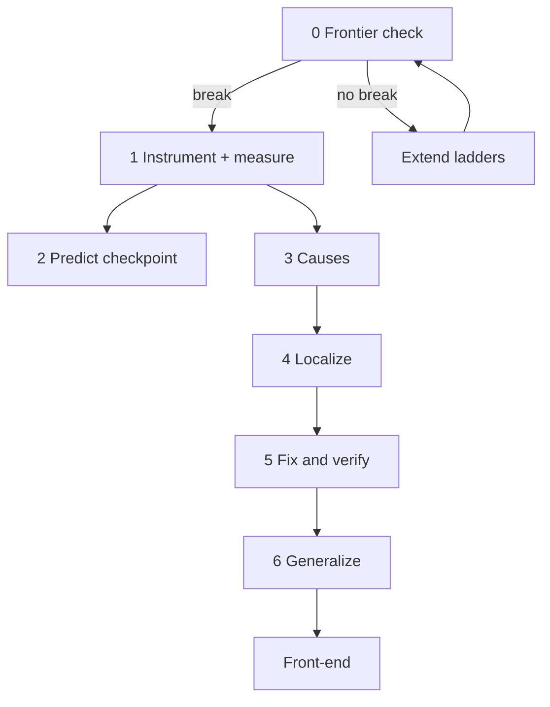

# Roadmap

v3 pipeline (2026-11-04). Detail in `docs/research_design.md`. Flowcharts: `docs/flowcharts.md` (sections 13 to 15). Week numbers below are the older v2 planning baseline; treat them as a schedule sketch, not a confirmed calendar.

| Stage | Weeks (sketch) | What | Gate |
|---|---|---|---|
| 0 Frontier check | before instrument | L1 to L3 on Opus, Fable, Astra, GLM and peers | Frontier models break somewhere; else extend ladders |
| 1 Instrument and measure | 1 to 7 | Generators, verifiers, QA, runner, noise floor; screening and fix-first pilots; main behavioural profiles | RQ1: stable contrast above noise. Gates later stages |
| 2 Predict | with Stage 1 | Three-baseline race on hidden tool-use sandbox | Reported checkpoint. Does **not** gate Stages 3 to 5 |
| 3 Causes | 8 to 10 | Controlled exposure on OLMo 3 7B + one replication family; OLMo training stages | Exposure detection AUC at least .75 |
| 4 Localize | 11 to 16 | Probe ladder: probes, patching, lens comparison, steering with controls | Pre-registered pass bars |
| 5 Fix and verify | 17 to 22 | Harness, SFT, RL, steering, weight edits; matched / strong / mismatch | Targeted beats baselines on reliability per unit cost |
| 6 Generalize | after first demo | New open model family through the pipeline | Minimal manual intervention |
| Later | product | Reliability front-end (rewrite, monitor, adaptive compute) | Beats generic prompt optimizers on calibrated tasks |

## Gating rule

- **Stage 0 first.** If frontier models do not break, extend ladders before building the instrument.
- **Stages 3 to 5 depend on RQ1** (reliable behavioural contrast), not on RQ3 (prediction beats baselines).
- Hidden-family prediction is a Phase 1 checkpoint, not a hard stop.
- If RQ3 fails: diagnose (measurement, transfer, or real null), report the pre-registered result; continue localize/fix if RQ1 holds, or pivot (reliability engineering, eval suite as product).

## First demonstration

Proposed (not frozen): **state loss** and **looping** end-to-end through measure → localize → fix → verify → generalize. Do not try all 17 failure types or all 8 abilities equally in the first demo.

## Outputs

- Paper 1: eval suite + profiles (+ prediction if it wins).
- Paper 2: cause + mechanism for one or two failures.
- Paper 3: fixes, cost, transfer, front-end sketch.

Paper split (one long paper vs series) is still open. Shared generators and failure labels across all papers.

Realistic sketch: first focused demo and Paper 1 measurement half inside a few months; full five-month v2 calendar is a baseline only.

Do not advance a stage because a result is exciting. Each gate requires the preceding construct to be measurable and reproducible.
