# Flowcharts

Clean Mermaid diagrams for the v3 research design. Raw ChatGPT paste archived in [`archive/background.md`](archive/background.md) §E; use this file.

These describe the **proposed** programme, not completed experimental results. Family G is a candidate. Demo numbers elsewhere on the site remain illustrative.

## How to read

1. Central idea → full architecture → V1/V2/V3
2. Taxonomies and ladders → benchmarks and generators
3. Models and statistics → prediction race
4. Interpretability → fixes → front-end
5. First demo (state loss + looping) → roadmap → papers

---

## 1. The central research idea

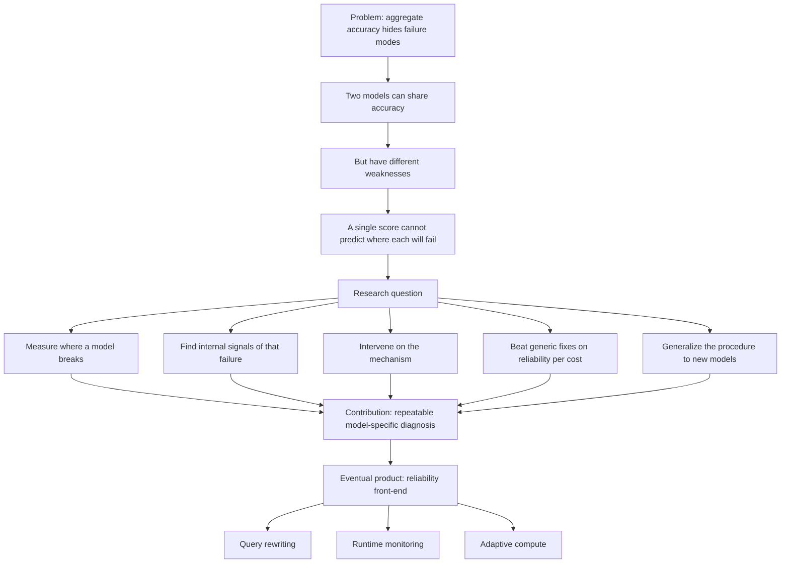

---

## 2. The complete research architecture

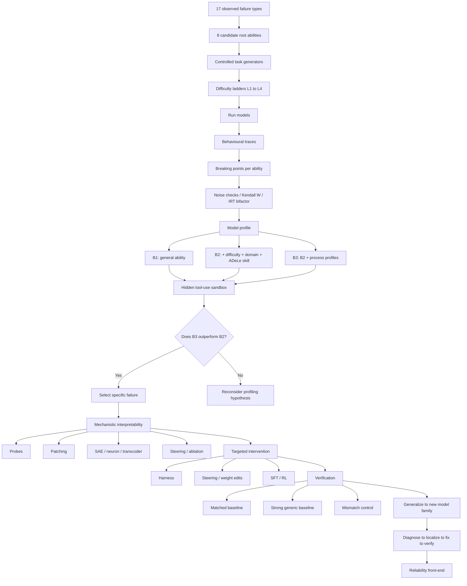

---

## 3. Evolution: V1 → V2 → V3

```mermaid
flowchart LR
  V1[V1: surface sensitivity] --> V1a[Rewording / reversal / plan-execute / false values]
  V1a --> V1b[Limits: instruction drift, difficulty confounds, n=1]
  V1b --> V2[V2: ability profiling]
  V2 --> V2a[Controlled benchmarks + breaking points]
  V2a --> V2b[Predict failures on unseen tasks]
  V2b --> V3[V3: mechanism and intervention]
  V3 --> V3a[Measure]
  V3a --> V3b[Localize]
  V3b --> V3c[Fix]
  V3c --> V3d[Verify]
  V3d --> V3e[Generalize]
```

---

## 4. Taxonomies: 17 failures → 8 abilities

Draft mapping. Not proven causal links. Some failures may involve several abilities.

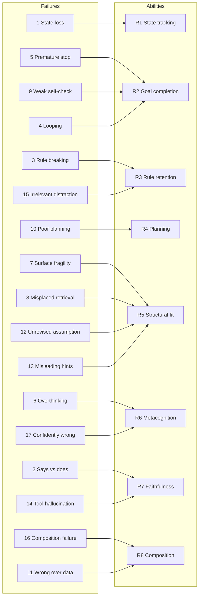

---

## 5. L1–L4 ladders

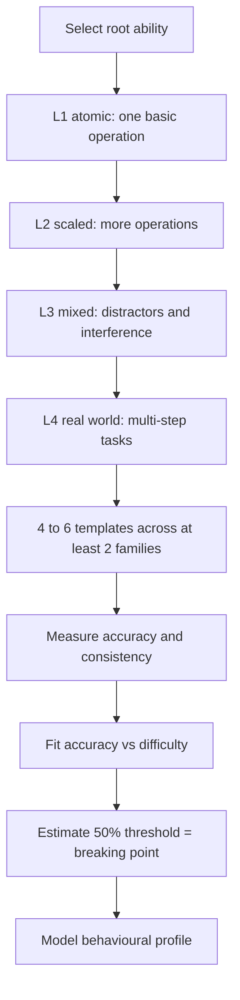

### Ability → profile measure

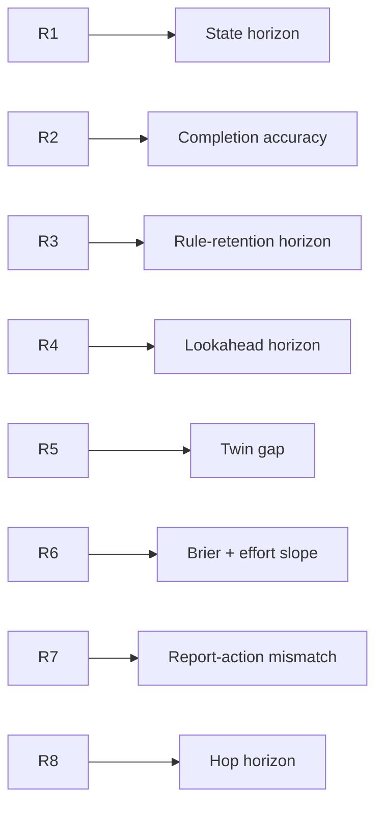

---

## 6. Benchmark architecture

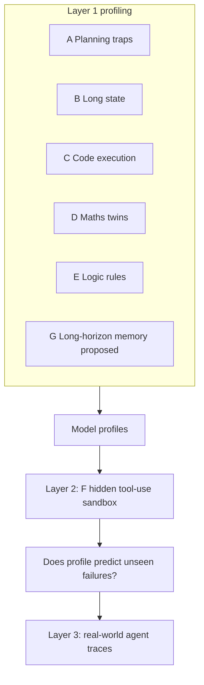

### Item generation pipeline

| Item type | Count per family |
|---|---:|
| Famous | 50 |
| Fresh twins | 50 |
| Fresh generated | 200 |
| Structural total | about 300 |
| Surface versions | about 5 each |

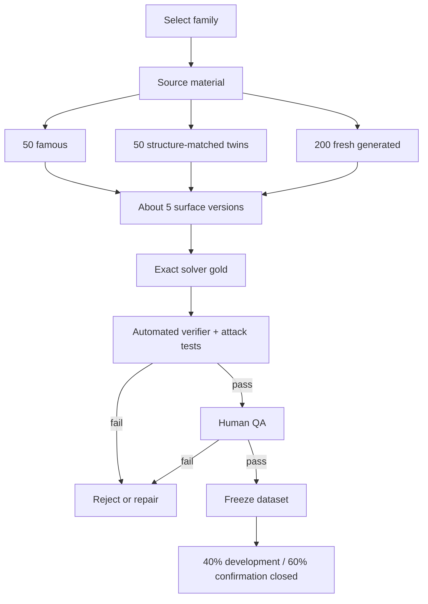

### One generator, five uses

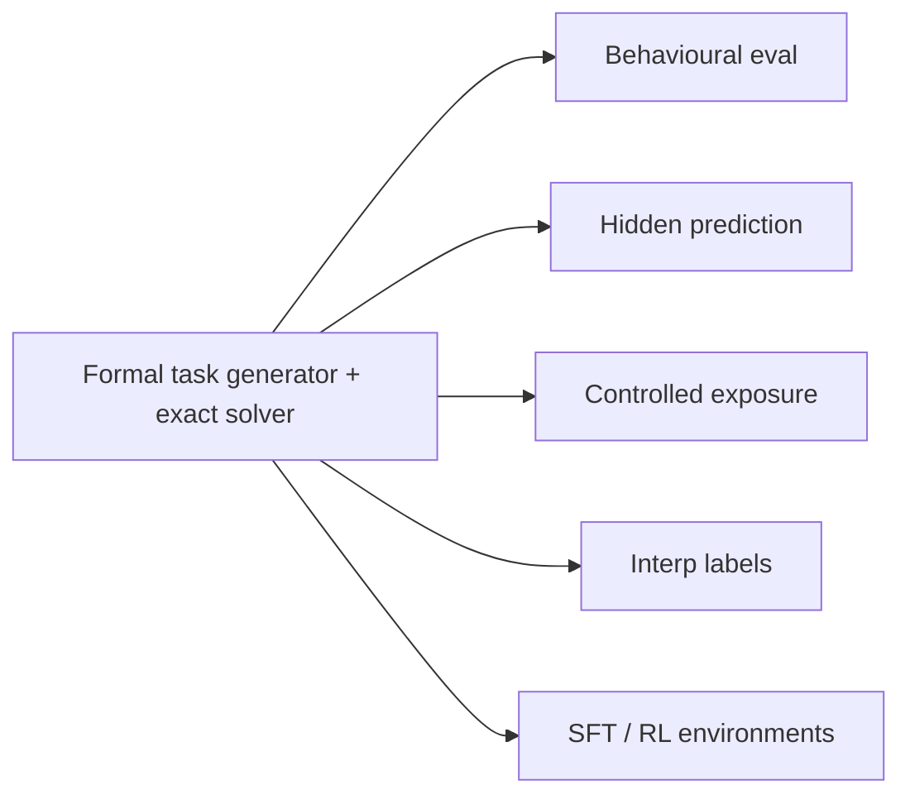

### Famous vs twin vs fresh

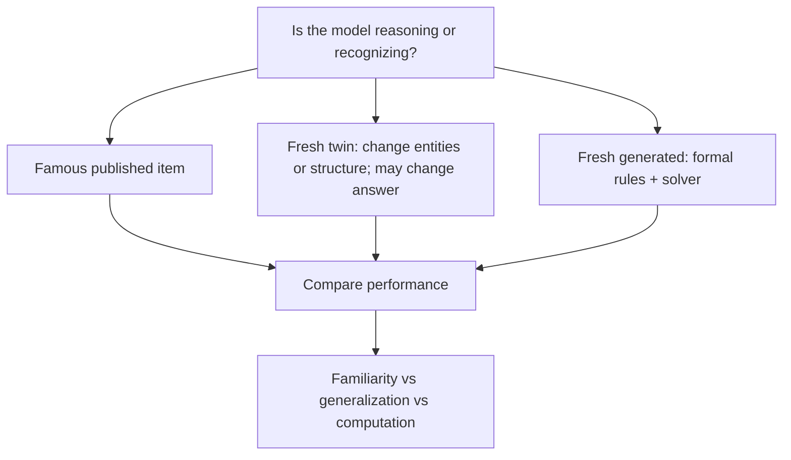

---

## 7. Model selection

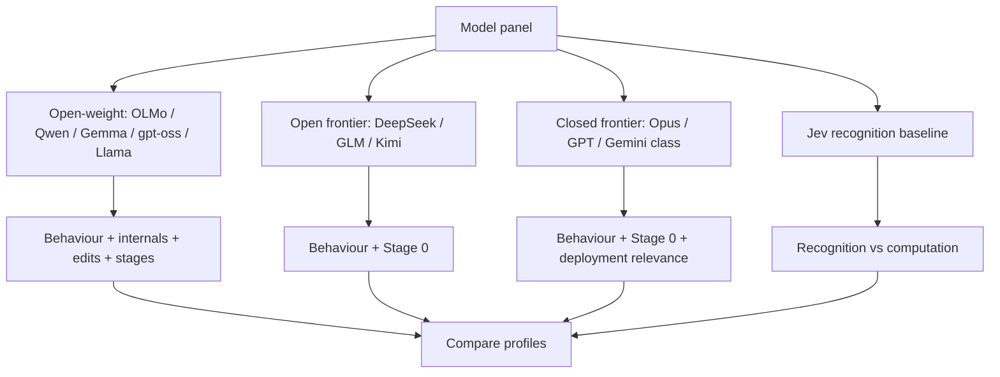

---

## 8. Statistics

### Noise and adaptive k

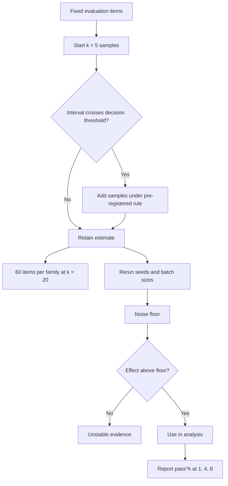

### Kendall's W

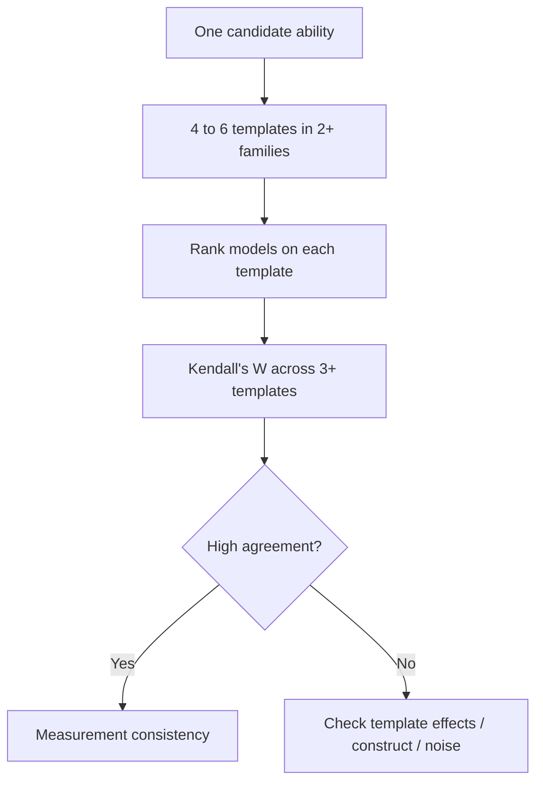

### Bifactor and prediction race

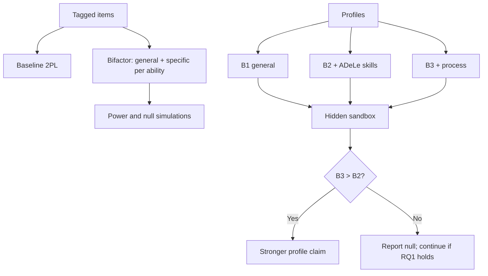

---

## 9. Mechanistic interpretability funnel

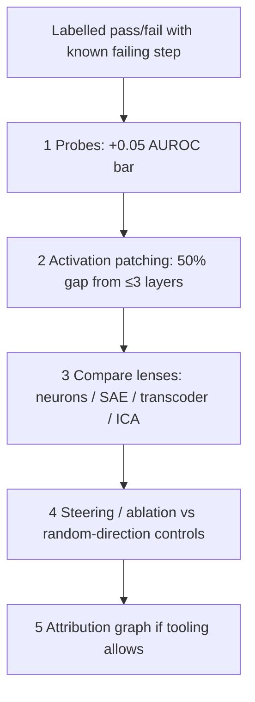

### Prediction vs causation

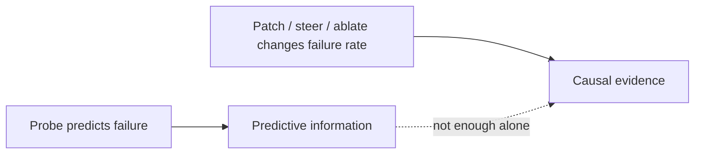

---

## 10. Fix and verify

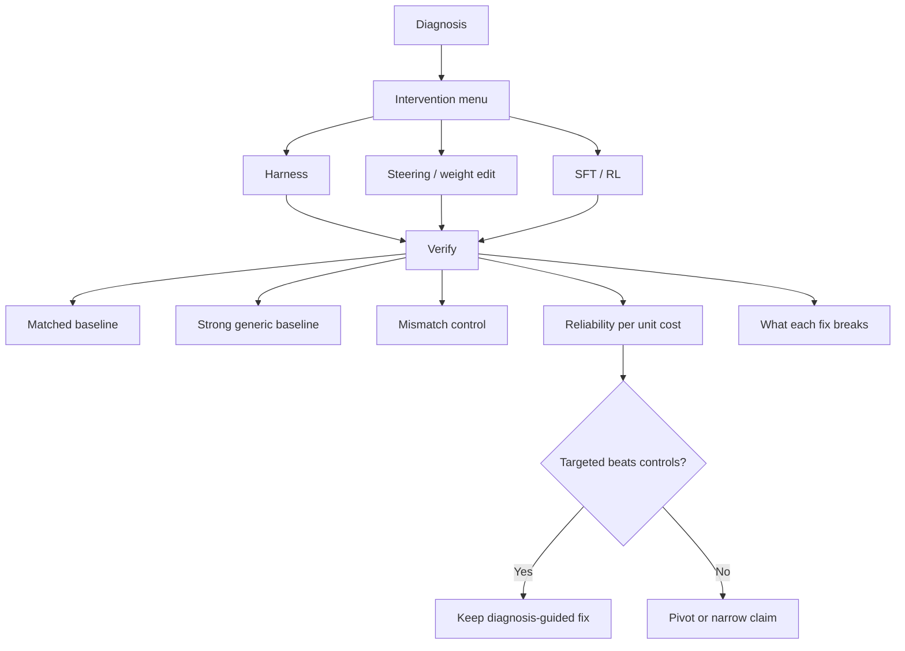

---

## 11. Reliability front-end

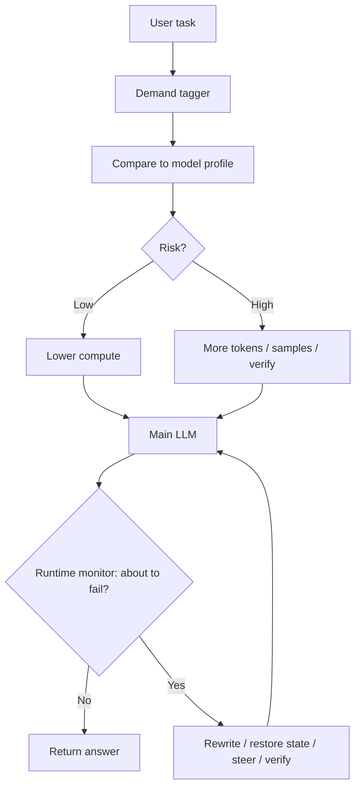

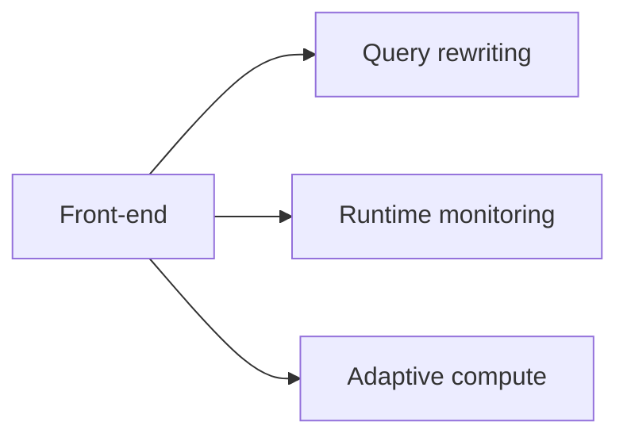

---

## 12. First end-to-end demo

Proposed first failures: state loss and looping.

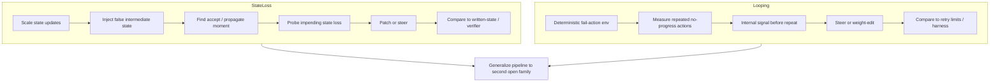

---

## 13. Execution roadmap

```mermaid
flowchart TD
  S0[0 Frontier sanity check] -->|models break| S1[1 Build instrument]
  S0 -->|do not break| EXT[Extend ladders]
  EXT --> S0
  S1 --> S2[2 Measure profiles]
  S2 -->|RQ1 holds| S3[3 Predict on hidden family]
  S2 -->|no contrast| FIXM[Fix measurement]
  FIXM --> S2
  S3 --> S4[4 Localize]
  S4 --> S5[5 Fix and verify]
  S5 --> S6[6 Generalize]
  S6 --> S7[7 Reliability front-end]
```

---

## 14. Five scientific claims

```mermaid
flowchart TD
  C1[C1: Abilities measurable above noise] --> C2[C2: Distinct beyond general skill]
  C2 --> C3[C3: Profiles predict held-out failures]
  C3 --> C4[C4: Internal signal is causal for a failure]
  C4 --> C5[C5: Diagnosis-guided fix beats matched / strong / mismatch]
```

---

## 15. Paper split (proposed)

```mermaid
flowchart LR
  P1[Paper 1: measurement and prediction] --> P2[Paper 2: mechanism]
  P2 --> P3[Paper 3: intervention and reliability]
  INF[Shared generators and failure labels] --> P1
  INF --> P2
  INF --> P3
```

Final split (one long paper vs series) remains open.

---

## 16. Reading the architecture

```mermaid
flowchart TD
  A[Why accuracy is not enough] --> B[17 failures and 8 abilities]
  B --> C[Ladders and generators]
  C --> D[Models and statistics]
  D --> E[Prediction checkpoint]
  E --> F[Localize]
  F --> G[Fix and verify]
  G --> H[Front-end]
  H --> I[First demo: state loss + looping]
```
