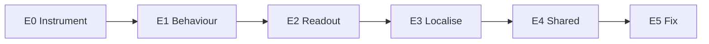

# Roadmap

Live programme: [`programme_architecture.md`](programme_architecture.md). Scientific detail: [`research_design.md`](research_design.md). Flowcharts: [`flowcharts.md`](flowcharts.md).

## Current focus: Q1 (state loss)

| Step | Objective | Gate |
|---|---|---|
| Sign-off | Adya ticks Q1 plan checkboxes; reads Guo THREAT note | No code before this |
| E0 | UpdateLedger generator, dual solvers, QA | All offline QA gates pass |
| E1 | Behaviour + competitor attribution | 30–70% failure cells per mode |
| E2 | Probes / logit lens on failures | C2 pass mark in prereg |
| E3 | Patching localisation | C3 pass mark |
| E4 | Shared vs separate causes | Flip-matrix rule in E4 |
| E5 | Seven fixes head-to-head with cost | C4: matched beats best generic |

Protocol: `research/protocols/state_loss/`.

## Nine-stage lifecycle (every failure)

From the programme architecture. Q1 is at stages 2–3 (literature + questions); implementation starts after sign-off.

| Stage | Objective | Decision rule |
|---|---|---|
| 1 Problem | Failure real in deployed models | ≥10% failure at realistic size in ≥2 strong models |
| 2 Literature | Know what is established | No paper already answers our question with causal tests |
| 3 Questions | Fix claims + kill conditions | Adya signs every claim |
| 4 Design | Data, models, controls, power | Each claim has dataset, control, pass mark |
| 5 Implementation | Generators, QA, fake models | All QA pass with no API key |
| 6 Execution | Pilot then confirmation | Prereg tagged before confirm |
| 7 Analysis | Pre-registered tests | Pass / fail / inconclusive per claim |
| 8 Validation | Second family, held-out, audit | Survives checks or claim narrows |
| 9 Writing | Paper + code + data | Deviations listed vs prereg |

## Wider programme stages (after / beside Q1)

| Stage | What | Gate |
|---|---|---|
| 0 Frontier check | L1–L3 on frontier panel | Models still break; else extend ladders |
| Measure | Profiles on root-ability ladders | Stable contrast above noise |
| Predict | Hidden tool-use sandbox (checkpoint) | Reported; does **not** gate localize/fix |
| Localize / Fix / Verify | As in Q1 E2–E5 | Pre-registered bars; matched vs generic vs mismatch |
| Generalize | Second open family | Minimal manual work |
| RR-Layer | Input-only cause → transform | Only after ≥2 failures clear fix stage |

## Gating rule

- Stages after measurement gate on a reliable behavioural contrast, not on prediction win.
- RR-Layer waits on Q1 E5 (and preferably a second failure).
- If a generic fix wins at equal cost, report that and stop the steering line for that failure.

## Papers (sketch)

1. Measurement + mechanism for computed-state loss (Q1).
2. Cause-matched vs generic fixes (cost).
3. Layer / transfer (only if 1–2 hold).
